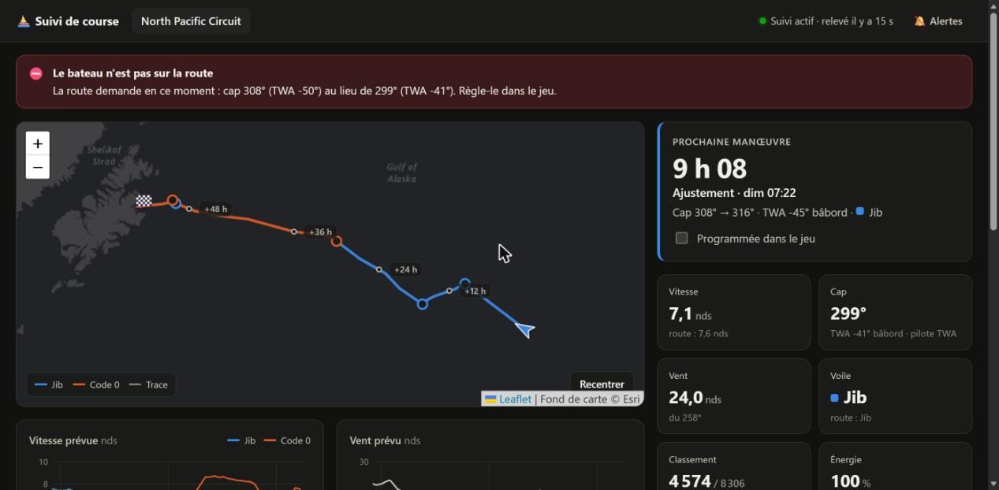

# ⛵ Virtual Regatta : suivi de course

Tableau de bord de suivi pour **Virtual Regatta Offshore** : il suit tes courses en direct et calcule en continu la route optimale avec [VRZen](https://routage.vrzen.org/). Il te dit aussi quelles manœuvres programmer dans le jeu, et quand.



---

## Ce qu'il fait

- **Détecte tes courses en cours** sur ton compte Virtual Regatta. Rien à configurer : rejoins une course dans le jeu, elle apparaît.
- **Suit le bateau chaque minute** : position, cap, TWA, vitesse, vent, voile, énergie et classement.
- **Recalcule la route VRZen toutes les heures** depuis la position réelle du bateau. Bouton « Recalculer » pour le faire tout de suite, par exemple après une nouvelle météo GFS.
- **Plan de programmation en pilote TWA.** La route est convertie en une douzaine d'actions (TWA + voile) pour toute la course. En pilote TWA, le bateau suit seul les bascules du vent : il suffit de saisir ces actions dans le programmateur du jeu. Un filtre 12 h / 24 h / Tout permet de programmer la nuit d'un coup, et chaque action se coche une fois saisie.
- **Vérifie que le bateau suit le plan** : bandeau vert s'il tient la bonne TWA et la bonne voile ; rouge sinon, ou s'il est en cap fixe au lieu du pilote TWA.
- **Route calculée avec tes voiles** : Jib et Spi de base, plus les voiles des options que tu as achetées. Pas de Code 0 dans la route si tu ne l'as pas.
- **Carte** avec ta trace, la route colorée selon la voile, des repères horaires (+12 h, +24 h…), les actions du plan, et l'arrivée.
- **Notifications** du navigateur 10 min avant chaque action non cochée, et quand le bateau s'écarte du plan.
- Graphiques de vitesse et de vent prévus, thème clair et sombre, utilisable sur mobile.

---

## Installation

Python 3.11 ou plus récent.

```
pip install -r requirements.txt
```

## Lancement

Double-clique sur **`Suivi de course.bat`**, ou lance :

```
cd src
python app.py
```

Le navigateur s'ouvre sur http://127.0.0.1:8765. À la première ouverture, la page demande tes identifiants Virtual Regatta. Le mot de passe est chiffré et reste sur ton PC, dans `src/credentials.json`.

Laisse la fenêtre ouverte : le suivi et le recalcul de la route tournent tant qu'elle tourne. Les traces et les routes sont enregistrées dans `src/data/` et retrouvées au prochain lancement.

---

## ⚠️ Pilotage automatique

Les versions précédentes envoyaient elles-mêmes les caps et les voiles au bateau (`src/gui.py`). **Virtual Regatta refuse désormais ces ordres** quand ils ne viennent pas du jeu (`ERR320 Bad API key`). Le projet sert donc au **suivi et au routage** : le pilotage passe par le pilote TWA et le programmateur du jeu, avec le plan calculé par le tableau de bord.

L'ancienne interface Tkinter est conservée dans `src/gui.py`. Elle affiche maintenant clairement les ordres refusés.

---

## Organisation du code

| Fichier | Rôle |
|---|---|
| `src/app.py` | Serveur web local (Flask) et point d'entrée |
| `src/core/tracker.py` | Suivi en tâche de fond : état du bateau, recalcul de la route, plan de programmation TWA |
| `src/api/race.py` | Lecture de l'API du jeu (courses, état du bateau, arrivée) |
| `src/api/vrzen.py` | Calcul de route VRZen |
| `src/web/` | Interface (HTML/CSS/JS, carte Leaflet) |
| `src/config.py` | Identifiants et identifiant VRZen (`VRZEN_USER_ID`) |

---

## 🛡️ Note

Projet personnel open source, **non affilié** à Virtual Regatta ni à VRZen.
